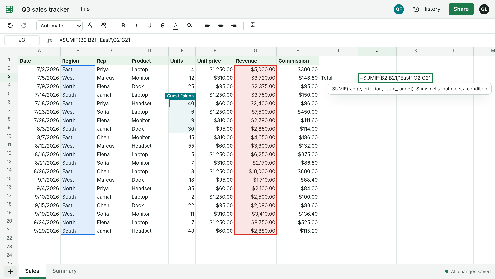
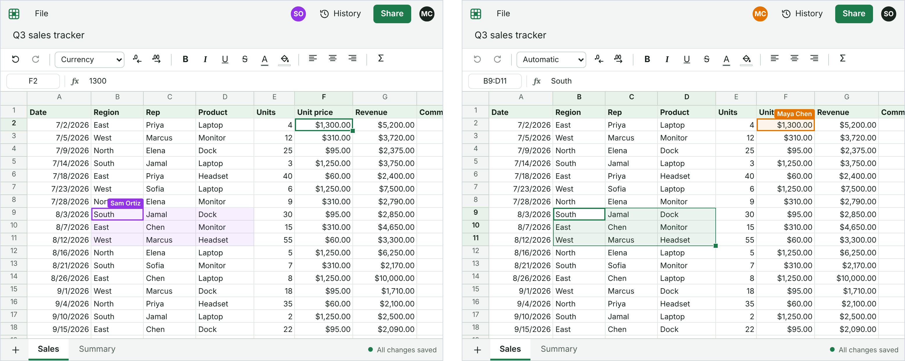
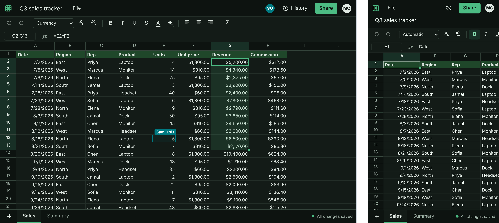
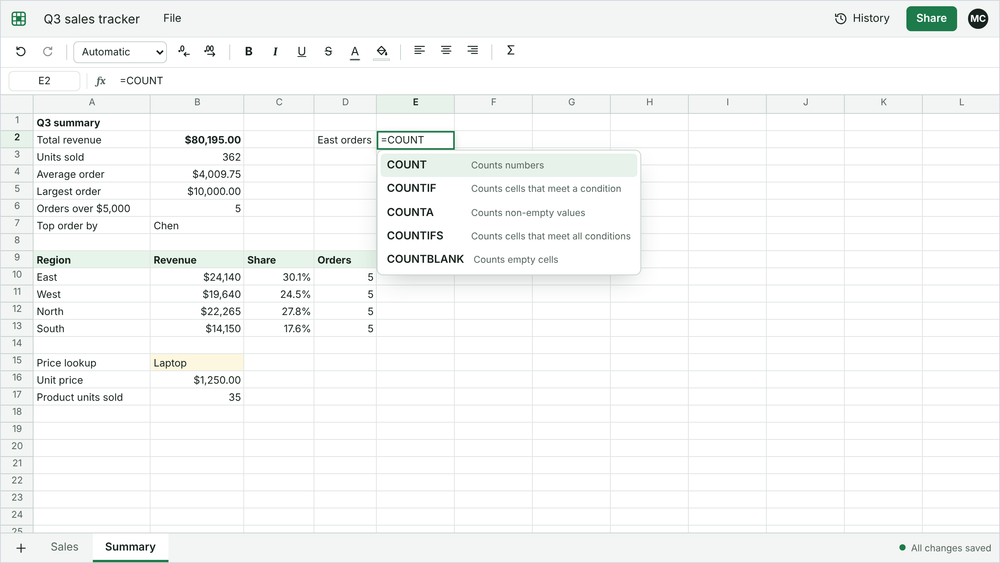
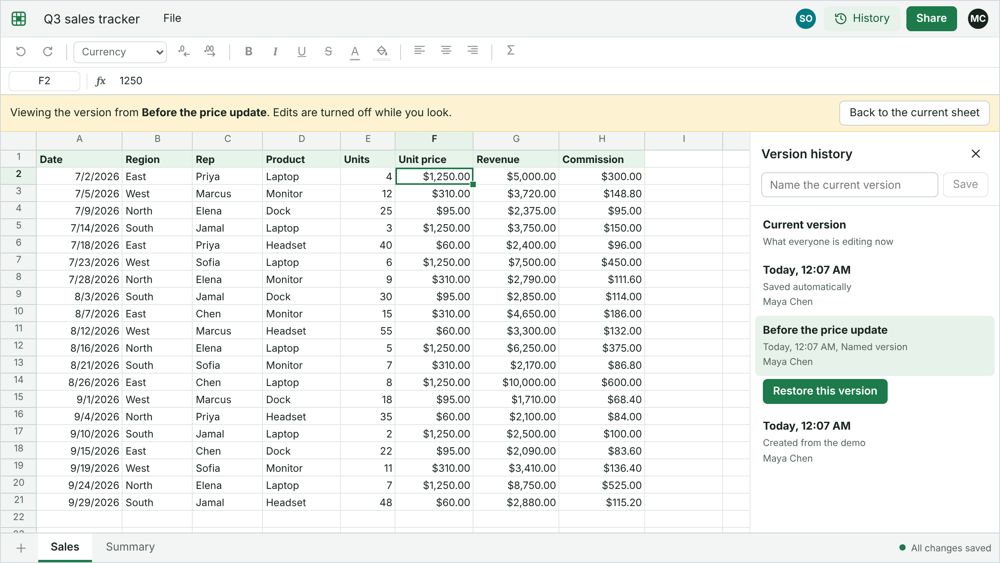

# realtime-collaborative-spreadsheet

A Google Sheets style spreadsheet that many people can edit at the same time, built from scratch with TypeScript, React, Fastify and Postgres.

I wanted a full stack project where the hard parts were mine. So instead of using a spreadsheet library I wrote my own formula engine, my own sync over WebSockets and my own canvas grid. Two people can type in the same sheet, insert rows under each other or lose their connection for a while, and everyone still ends up with the same sheet.



## What it does

- Live editing with everyone's selection and name shown on the grid
- Over 100 functions, like SUMIFS, XLOOKUP, INDEX and MATCH, TEXT and DATEDIF
- Formulas keep pointing at the right cells when rows or columns are inserted or deleted
- Copy and paste (also from Excel or Google Sheets), a fill handle that continues series, and undo and redo
- Tabs, number formats, colors, alignment and column sizes
- Sharing by link (view or edit) or by email
- Version history where you can name versions, preview them and restore one for everyone
- CSV import and export
- Guest accounts, so you can try it without signing up
- Edits made while offline are saved when you reconnect
- Dark mode and a layout that works on phones

Here are two browsers open on the same sheet. Maya (left) changes the laptop price in F2, and Sam (right) sees the new price, the new revenue and her cursor right away. She sees his selection on her side too.



The same sheet in dark mode, on a laptop and on a phone.



## Results

All numbers are from my HP OmniBook 5 laptop (Intel Core 5 120U, plugged in) on Windows 11 with Node 24. The scripts are in `bench/` and their sizes are set in `config.toml`.

### Recalculation

A sheet with 100,000 rows where every row has two formulas, plus four formulas at the top that read whole columns (SUM, AVERAGE, COUNTIF and SUMIF). That is 200,004 formulas.

| step | median | p95 |
|---|---|---|
| recalculate every formula | 3.7 s | |
| edit one input cell | 31.1 ms | 45.3 ms |
| insert a row in the middle | 82.6 ms | 195 ms |
| open the sheet from JSON (17.3 MB) | 2.75 s | |

An edit only recalculates the cells that depend on it. Here that includes the four whole column formulas, so every edit still reads 100,000 rows four times.

### Live sync

50 clients connect to one sheet and each one sends 200 edits at 20 edits per second, so 1,000 edits per second in total. Every client has to receive every edit. Latency is the time from sending an edit until it comes back from the server, which only happens after the edit is saved in the database.

| | group commit | one commit per edit |
|---|---|---|
| edits per second | 999 | 426 |
| latency median | 9.2 ms | 8.9 s |
| latency p95 | 13.5 ms | 16.2 s |
| latency p99 | 20.1 ms | 19.9 s |
| database commits | 1,440 | 10,000 |

With group commit the server saves all the edits that came in while the last commit was running in one transaction. With one commit per edit the database can't keep up, edits pile up in a queue and the delay keeps growing.

### Scrolling

Headless Chromium scrolling a 100,000 row sheet with three formulas per row for 10 seconds, at 1440x900 and 2x pixel density.

| | median | p95 | p99 |
|---|---|---|---|
| time between frames | 16.7 ms | 16.8 ms | 16.8 ms |
| redraw of the visible cells | 2.4 ms | 3.1 ms | 4.9 ms |

It held 60 frames per second, and only 1 of the 600 frames came late. The grid is one canvas that only draws the cells on screen, with a normal scrolling div on top of it for the scrollbars.

## How it works

### Rows and columns have ids

Every row and column gets a unique id when it is created. Cells are stored by row id and column id, not by position. Formulas also store their references as ids and only turn them into A1 text when you look at them. So if you write `=B5*2` and someone inserts a row above row 5, your formula turns into `=B6*2` and still points at the same cell. Deleted rows are only marked as deleted. An edit that arrives for a deleted row still applies, and undo can bring the row back with its data.

### Sync

The server is the source of truth. Every change is an op, like "set these cells" or "insert these rows". The browser applies its own ops right away and sends them to the server. The server checks each op, gives it a sequence number, saves it and sends it to everyone in the sheet. When an op from someone else comes in, the browser rolls back its own unconfirmed ops, applies the new op and replays its own ops on top. Since ops use ids and not positions, the replay almost never conflicts. If an op doesn't make sense anymore, like when two people delete the last two tabs at the same time, the server rejects the second one and that browser drops it.

When a browser reconnects it sends the last sequence number it has. The server sends back only the ops it missed, or the whole sheet if it is too far behind. Ops also carry a number from the client, so an op that gets sent twice after a reconnect is only applied once.

The sync code has a property test with fast-check. Three fake clients edit, send, receive, disconnect and reconnect in a random order. The fake server rejects some ops at random and sometimes restores an old version. At the end every client has to match the server exactly.

### Formulas

The parser is a Pratt parser with Excel's precedence rules, so `=-2^2` gives 4 like in Excel. The engine keeps a dependency graph, so an edit only recalculates the cells that depend on it, in topological order. Circular references show `#CYCLE!` instead of hanging. Another property test makes random edits, inserts and deletes and checks that the incremental results always match recalculating the whole sheet from scratch.

While you type a formula, the grid lists the functions that match, with a short description of each.



### Undo and history

Undo only takes back your own changes. If someone else changed a cell after you, undo leaves their edit alone.

The server saves a snapshot of the sheet every 500 ops or every 5 minutes, and those snapshots are the version history. You can also save a named version. Restoring a version replaces the sheet for everyone who has it open.

Here a named version is open in preview. The grid shows the old prices, and editing is off until you go back or restore it.



### Security

Passwords are hashed with scrypt, and session cookies hold random tokens that the database only stores as SHA-256 hashes. Every write checks the Origin header, WebSocket messages are rate limited per connection and every message is validated with zod. CSV export puts an apostrophe in front of text that starts with `=`, so Excel won't run it as a formula.

## Stack

TypeScript everywhere. Node runs the server's TypeScript directly, so the server has no build step. React 19 and Vite for the client, Fastify 5 with WebSockets for the server and Postgres through Drizzle ORM. By default it uses PGlite, which is Postgres compiled to WebAssembly, so you don't need to install a database to run it. Tests use Vitest, fast-check and Playwright.

## Running it

You need Node 22.18 or newer.

```
npm ci
npm run dev
```

Then open http://localhost:5173 and click "Try it with a demo sheet". You get a guest account with a sales sheet to play with. To see live editing, open Share, set the link to "Can edit" and open the link in a private window.

The data goes to `data/pglite`. To use a real Postgres instead, set `DATABASE_URL`.

For a production build:

```
npm run build
npm start
```

That serves everything on http://localhost:3000.

Every setting lives in `config.toml`, like size limits, rate limits, snapshot timing and the benchmark sizes. Any of them can be changed with an environment variable, for example `SPREADSHEET_AUTH_SECURE_COOKIES=true`.

## Tests

```
npm test
npm run e2e
npm run lint
```

`npm test` runs 312 unit and server tests. `npm run e2e` runs 11 browser tests, including two browsers editing the same sheet, and needs `npx playwright install chromium` once. GitHub Actions runs all of them on every push to main, with the server tests running against both PGlite and Postgres 16.

The benchmarks are `npm run bench:recalc`, `npm run bench:sync` and `npm run bench:scroll`.

## Project layout

```
shared/   document model, formula engine, sync and undo, used by both sides
server/   Fastify app, live rooms, accounts and the database
web/      React app and the canvas grid
e2e/      Playwright tests
bench/    benchmark scripts
```
